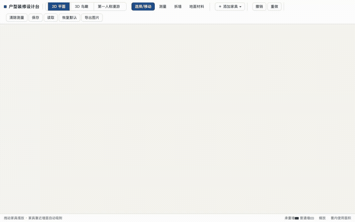
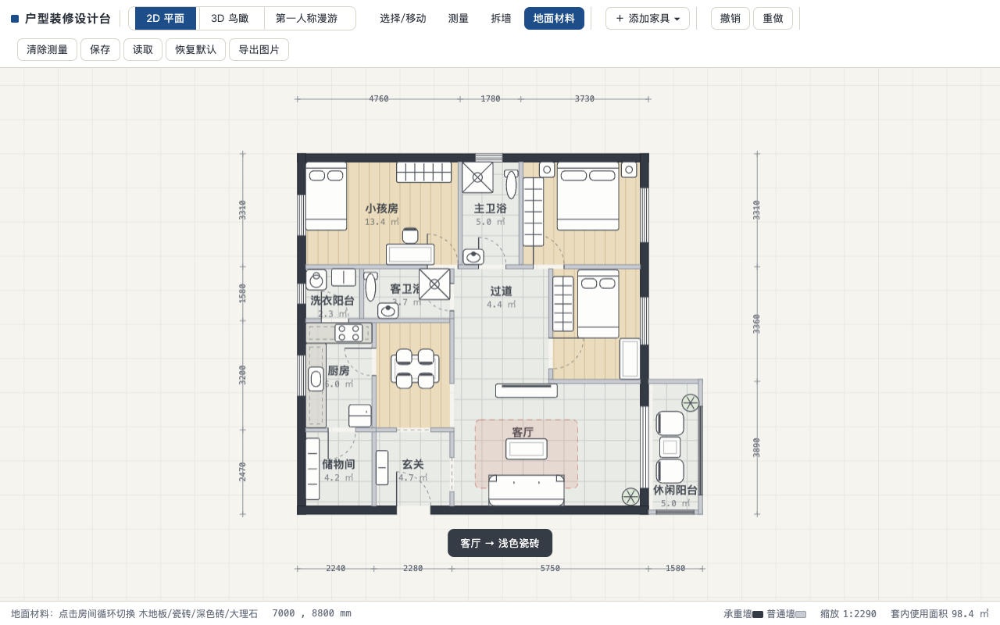
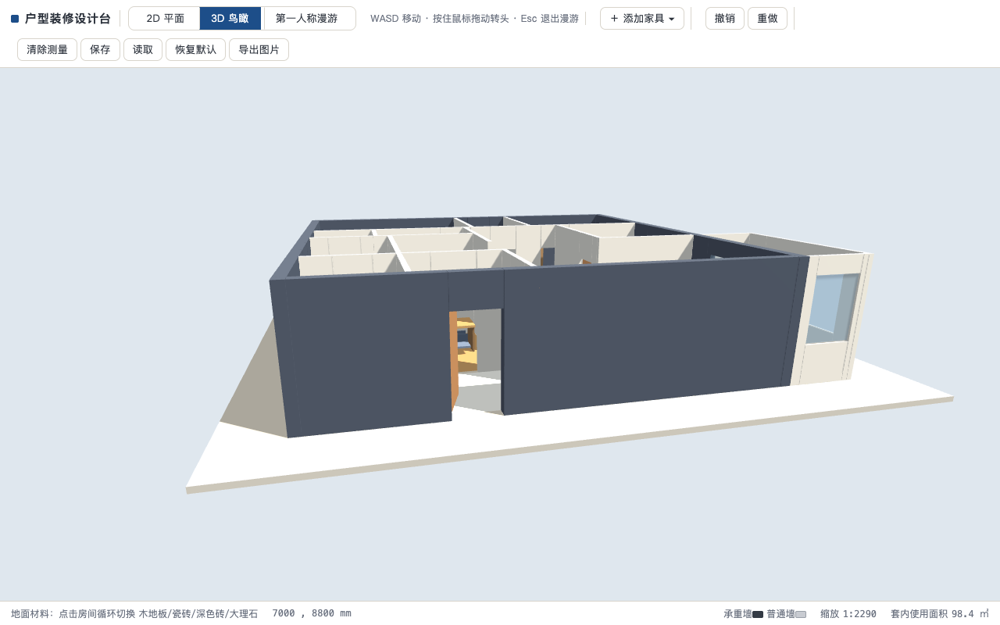

# 装修设计台 · 单文件 HTML

一个 **零构建、零依赖、离线可用** 的户型装修设计工具：全部功能装在一个 `index.html` 里（约 1300 行），配一个本地化的 three.js。



**在线体验**：<https://jiangbin-ai.pages.dev/apps/reno/>（亦可直接双击打开 `index.html`）

## 功能

| 模块 | 能力 |
|---|---|
| 2D 平面 | 墙体/门窗按真实尺寸（mm）绘制，承重墙与普通墙分色，四周自动标注尺寸链，房间自动计算面积 |
| 家具 | 预置 40 件真实尺寸家具；拖动 / 旋转（R）/ 改尺寸；靠近墙面自动吸附贴齐 |
| 交互 | 测量工具（mm 级）、拆除非承重墙（承重墙保护）、地面材料切换（木地板/瓷砖/深色砖/大理石）、撤销重做、本地保存、导出 PNG |
| 3D | three.js 生成同一套方案：墙洞门窗切割、鸟瞰旋转、第一人称漫游（WASD + 拖动转头） |
| 切换 | 2D/3D 同页过渡动画，单一数据源双向实时同步 |




## 快速开始

```bash
git clone https://github.com/jiangbingo/reno-design-tool.git
cd reno-design-tool
open index.html        # 或任意静态服务器
```

换自己的户型：编辑 `index.html` 顶部的 `defaultState()` 数据段（墙体/洞口/房间/家具四个数组，单位 mm）。

## 交互验收测试

用 Playwright 合成真实指针/键盘事件，对 8 条核心交互做断言（拖拽吸附是否毫米级贴墙、测量是否精确、承重墙是否真的不可拆等）：

```bash
npm install
npm test               # 8 passed
```

典型断言示例：把一张床推到墙边，断言其边缘坐标与墙面坐标**完全相等**（吸附不是"看起来贴上了"）；拆掉普通墙后墙数减一，再点承重墙墙数不变。

## 实现要点

- **mm 级单一数据源**：墙体/洞口/房间/家具全部是平面坐标系里的数据，2D Canvas 与 3D 场景都从它生成——两边同步不需要写一行同步代码。
- **墙洞切割**：洞口（门/窗/推拉门）在渲染期把墙拆成段 + 过梁/窗台盒，3D 里门扇绕合页旋转。
- **吸附算法**：拖动时对全部墙面做最近面检测（阈值 110mm），命中即平移贴齐并把旋转角规整到正交。
- **撤销栈**：快照式（walls/openings/furniture/floors 深拷贝），上限 60 步。

## 灵感与署名

创意与原始提示词来自 X 用户 [@akokoi1](https://x.com/akokoi1) 的[热门分享](https://x.com/akokoi1/status/2104520072014508316)（原始演示[视频](https://x.com/akokoi1/status/2104520458444099694)由 Opus 5.5 生成）。本仓库是参考其功能描述后的**独立实现**（AI 结对编码完成），并补充了原作没有的自动化交互验收——如何用工程手段验收 AI 生成的交互产物，见测试目录与[配套博文](https://jiangbin-ai.pages.dev/blog/2026-10-01-reno-tool-replica-e2e)。

依赖致谢：[three.js](https://threejs.org/)（MIT，`three.min.js` r128 本地化以支持离线）。

## License

[MIT](LICENSE)
